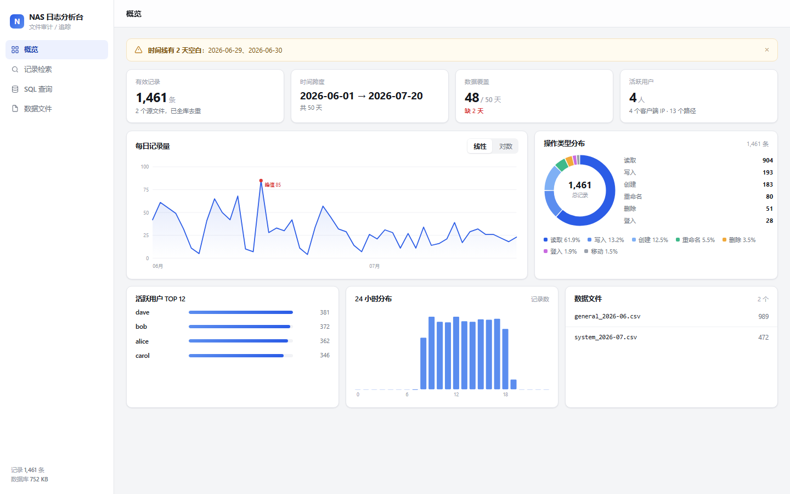
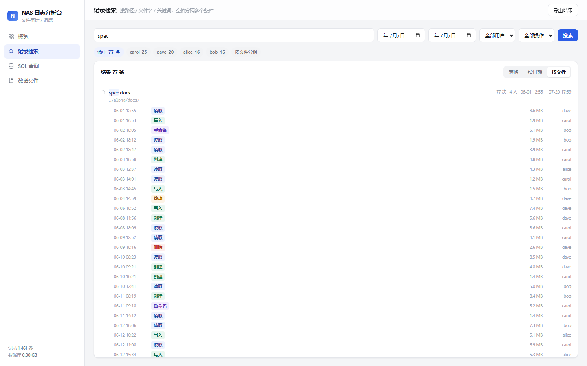

# NAS 日志分析台

把群晖（Synology）NAS 审计日志导出的 CSV 变成一个可检索、可统计的本地工具。
纯 Python 标准库 + 浏览器，不联网、不装依赖、数据不出本机。



## 为什么需要它

群晖的「日志中心」只能按页翻，导出成 CSV 之后也不好用：

- 一个文件被谁在什么时候动过，要在几万行里翻
- 每次导出都换一个文件名，多份导出之间大量重复
- 文件操作的信息全压在 `消息` 一列里，没法直接筛选

这个工具把这些 CSV 收进一个 SQLite 库，去重之后用界面查：按关键词搜路径、按人/按时间筛、看某个文件的完整操作轨迹。

## 快速开始

需要 Python 3.8+（Windows 上确认 `python` 命令可用）。

本项目已经部署在本机，直接双击根目录 **`start.bat`** 即可（等价于 `python tool/server.py`）。

开源地址：https://github.com/szjmhxd/nas-log-analyzer （代码已脱敏，只保留工具本体，不含任何业务数据）

默认端口 8777。被占用时会依次试 8778~8782、8081、8090，都不可用才交给系统分配，实际地址以控制台打印的那一行为准。也可以直接指定：

```bash
set PORT=8888 && python tool/server.py          # Windows
PORT=8888 python tool/server.py                 # macOS / Linux
```

## 四个页面

| 页面 | 用途 |
|---|---|
| **概览** | 记录总量、时间跨度、覆盖天数与缺失日期告警；每日记录量折线图（线性 / 对数一键切换）、操作类型占比、活跃用户排行、24 小时分布 |
| **记录检索** | 关键词搜文件名 / 目录名 / 用户名（空格分隔多个条件）+ 日期 / 用户 / 操作 / 类型筛选；表格、按日期、按文件、按文件夹四种视图；结果可导出 CSV |
| **SQL 查询** | 直接写 SELECT，内置 8 个模板，`Ctrl/⌘ + Enter` 执行；只允许读操作 |
| **数据文件** | 拖拽导入、查看已导入文件、按文件移除数据 |

### 四种视图的分工

- **表格**：一行一条记录，适合快速扫一遍、看 IP 和大小
- **按日期**：同一天发生了什么，适合复盘某天
- **按文件**：以文件为单位聚合，把同一份文件被谁、在什么时候、做过什么串成一条轨迹
- **按文件夹**：按所在目录汇总，回答"这个目录里有多少文件、被几个人动过"



「按文件」这个视图是排查时的主力：一个目录三个月里被谁动过、某份合同改过几次名字，一眼能看完。

切换视图只重画、不重新查库，所以在四个视图之间来回看没有等待。

### 同一份文件只算一条

文件改名之后，日志里就变成了两个不同的路径。按路径分组会把"改名 → 删除"拆成两条记录，看起来像两个文件。

这里把改名 / 移动记录连成链，沿链回溯到最早的名字，同一份文件的所有记录归到一组，并列出曾用名：

```
合同/报价单.xlsx       06-10 17:08 创建
              → 报价单-终版.xlsx  06-10 17:12 重命名
                                  09-11 13:32 删除
```

目录整体改名会连带改变所有子文件的路径，这种情况也会按改名时间把子路径回写成改名前的形式，所以"整个文件夹改名"之后的历史同样能串起来。

`新建文件夹` 这类会被反复使用的名字，按"该名字下一次被改走的时间"区分代次，避免把几百个互不相干的文件串成一条。

## 检索为什么快

200 万行时，直接在原表上做 `LIKE '%关键词%'` 要扫 2 GB，单次约 2 秒；一次检索要扫四遍（总数、明细、事件分布、用户分布），合起来 10 秒。

改成两张窄表后降到 1 秒以内：

| 表 | 内容 | 作用 |
|---|---|---|
| `dirs` | 9 万个唯一目录 | 搜目录名时先在 10 MB 的小表里匹配，再用索引反查记录，60 ms |
| `sidx` | 每行的文件名 / 目录 id / 时间 / 事件 / 用户 | 只扫 190 MB，一次扫描同时算出总数、明细、事件分布、用户分布 |

时间在索引里存成整数（`20260831110314`），日期筛选和排序都不用再做字符串转换。

目录命中数很大时（比如搜"合同"命中 9000 个目录），用 `did IN (SELECT ...)` 走 `i_sidx_did` 索引，不会退化成全表扫描。

## 支持的导出格式

导入时自动识别，不需要手动选：

| 格式 | 表头 | 常见来源 |
|---|---|---|
| 7 列 | `日期,时间,优先层级,主机名称,分类,程序名称,消息` | 日志中心「全部日志」 |
| 8 列 | `日志,时间,IP 地址,用户,事件,文件/文件夹,文件大小,文件名称` | 文件传输日志 |
| 9 列 | `主机名称,日志,时间,IP 地址,用户,事件,文件/文件夹,文件大小,文件名称` | 文件传输日志（带主机名） |

会自动处理这些脏数据：

- UTF-8 BOM、GBK 编码
- 开头多出来的分类标签行（`全部` / `系统`）
- 分页导出夹在中间的重复表头
- 混用的日期格式（`MM/DD/YYYY`、`YYYY/MM/DD`，带秒或不带秒）
- 把 `Event: read, Path: ..., Size: 1.97 KB, User: ..., IP: ...` 拆成独立字段
- 把 `1.97 KB` / `4.79 MB` 换算成字节

## 去重

同一批数据被导出多次、甚至换了个文件名再导一遍，是很常见的情况。

导入后全库按（时间, 用户, 事件, 路径, 大小, 类型）判重，只保留最早一条。所以重复导入不会让统计虚高。

## 数据放在哪

```
项目根目录/
  logs.db            SQLite 数据库（唯一的分析数据源）
  clean/             规范化后的 UTF-8 CSV
  tool/
    server.py        本地 HTTP 服务
    parser.py        解析、清洗、入库
    static/index.html 单文件界面
  start.bat          Windows 启动脚本
```

`logs.db` 和 `clean/` 都在 `.gitignore` 里，不会进版本库。

发布版仓库里额外有 `sample/`（虚构示例数据 + 生成脚本）、`docs/`（截图）、`start.bat`、`LICENSE`。

## 已知限制

- **概览第一次打开要等几秒**：200 万行做多次全表聚合，约 5 秒。算完会写进缓存（内存 + `tool/.cache/`），后续打开和重启都是毫秒级；导入新数据后会在后台预热。
- **日志量级的尖峰要单独看**：批量编译、解压这类操作能在一天内产生几十万条创建记录，会把每日趋势的均值拉歪。折线图在最大/最小值差距超过 40 倍时自动切对数轴，也可以手动切。
- **大库占空间**：200 万行约 2.6 GB。其中约 190 MB 是检索索引 `sidx`、20 MB 是目录表，另有一部分是让去重从 75 秒降到 2 秒的指纹索引 `i_fp`。磁盘紧张可以删掉 `i_fp`，代价是每次导入后多等一分钟。
- **关键词不再搜"消息"原文**：检索索引存的是文件名、目录名、共享名和用户名。原始 `消息` 列里的路径、用户、IP 都已经拆成独立字段，所以实际检索覆盖范围没有变小，但极少数只出现在原文里的字样（比如客户端主机名）搜不到，这类请用 SQL 查询。
- **检索最多收 30 万条命中**再汇总，超过时结果标记为"≥ 30 万"，此时建议加日期或用户条件收窄。

## 命令行

不想开界面时可以直接查库：

```bash
python -c "import sqlite3;c=sqlite3.connect('logs.db');print(c.execute('select user,count(*) from logs group by 1 order by 2 desc limit 10').fetchall())"
```

## 许可

MIT
